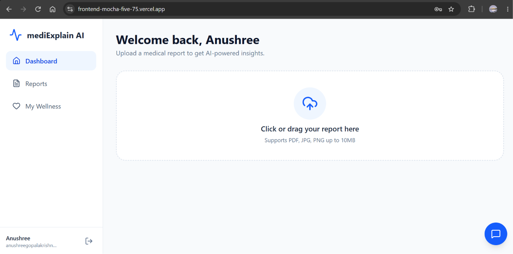
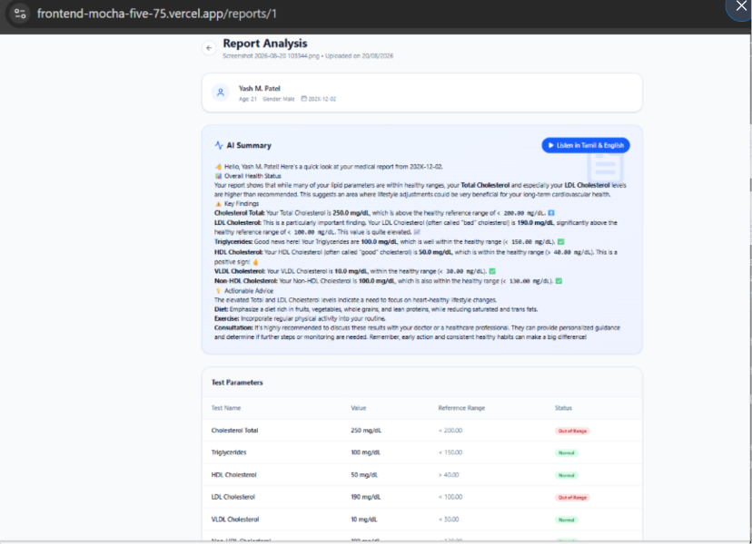
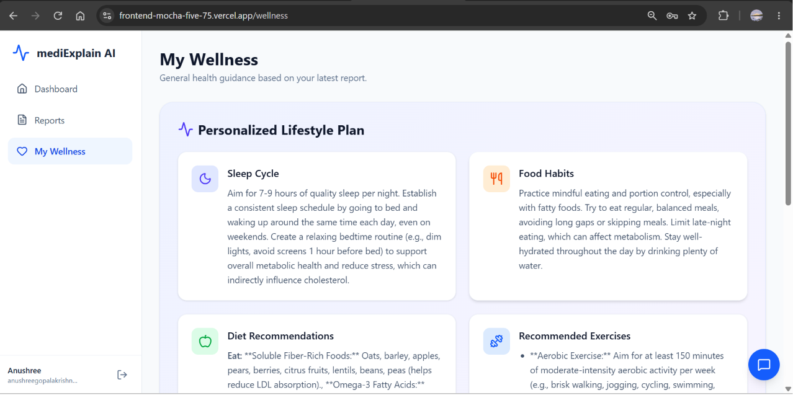
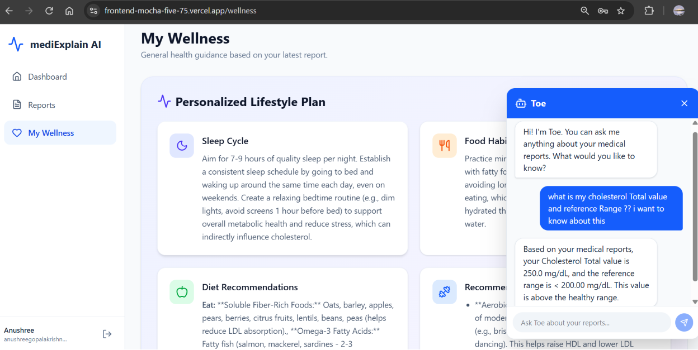

# mediExplain AI ⚕️ Tech for Good 2026

**Team:** 290 - AI Rangers

**Live Demo URL:** https://medi-explain-ai-eta.vercel.app/

## Overview
mediExplain AI is a patient-friendly platform that analyzes complex medical reports and explains them in simple language. It provides an overall health summary, highlights key findings, offers personalized lifestyle recommendations, and includes an AI chat assistant (Toe) to answer patient questions about their reports in both English and Tamil.

## Application View

### Report Upload
Upload medical reports in PDF, JPG, or PNG format to begin an AI-powered analysis.



### AI-Powered Report Analysis
The report view provides an AI summary, test parameters, reference ranges, and status indicators to help users understand their results.



### Personalized Wellness Plan
Get practical recommendations for sleep, nutrition, diet, and exercise based on the user's latest report.



### Ask Toe — AI Health Assistant
Toe can answer questions about the analyzed report, provide context for health values, and explain reference ranges in plain language.



## Architecture
- **Frontend:** React, Vite, TypeScript, TailwindCSS
- **Backend:** Python, FastAPI, SQLite
- **AI Integration:** Google Gemini API for medical report analysis and chat

## How to run locally

### Backend Setup
1. Navigate to the `backend` directory:
   ```bash
   cd backend
   ```
2. Install dependencies:
   ```bash
   pip install -r requirements.txt
   ```
3. Create a `.env` file in the `backend` folder with your Gemini API key:
   ```bash
   GEMINI_API_KEY="your_actual_gemini_api_key_here"
   ```
4. Start the server:
   ```bash
   uvicorn main:app --reload
   ```

### Frontend Setup
1. Navigate to the `frontend` directory:
   ```bash
   cd frontend
   ```
2. Install dependencies:
   ```bash
   npm install
   ```
3. Create a `.env.local` file in the `frontend` folder to point to the local backend:
   ```bash
   VITE_API_URL="http://127.0.0.1:8000"
   ```
4. Start the development server:
   ```bash
   npm run dev
   ```
